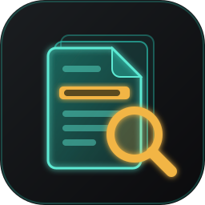
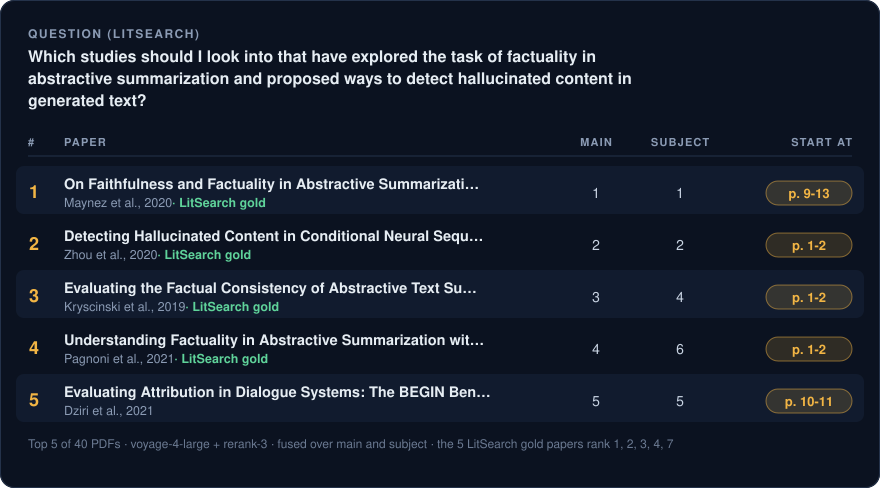

<!-- markdownlint-disable MD033 MD041 -->

<p align="center">
  
</p>

<h1 align="center">paper-lector</h1>

<p align="center">
  <strong>Agent Skill for Claude Code and Codex</strong><br>
  <sub>Ranks research PDFs and suggests starting pages; reading leads, not evidence.</sub>
</p>

<p align="center">
  
  
  
  
  
  
</p>

<h3 align="center">
  <a href="#overview">Overview</a>
  &nbsp;·&nbsp;
  <a href="#install">Install</a>
  &nbsp;·&nbsp;
  <a href="#example-underwater-routing-papers">Example</a>
  &nbsp;·&nbsp;
  <a href="#search-modes">Search modes</a>
  &nbsp;·&nbsp;
  <a href="#how-ranking-works">How it works</a>
  &nbsp;·&nbsp;
  <a href="REFERENCE.md">Reference</a>
</h3>

---

<p align="center">
  
</p>

<p align="center"><sub>A real run on 40 open-access PDFs: one <a href="https://huggingface.co/datasets/princeton-nlp/LitSearch">LitSearch</a> question, its 5 gold papers and 35 distractors from nearby topics. MAIN and SUBJECT are each paper's rank on those two queries; START AT is the first window the reranker read for the main query. The papers, the run record and the script that draws this image are in <a href="examples/litsearch">examples/litsearch</a>.</sub></p>

## Overview

paper-lector is an agent skill for Claude Code and Codex with three scripts:

- `openalex_search.py` searches OpenAlex (keyword, semantic, citing works, references).
- `fetch_pdf.py` downloads open-access PDFs and lists the rest for manual download.
- `rank.py` ranks your own PDFs against a few frozen research-question queries and tells you which pages to read first.

[`SKILL.md`](SKILL.md) is the guide the agent reads. [`REFERENCE.md`](REFERENCE.md) has every option, output file and edge case.

## Install

You need Python 3.12 and `pdftotext` from poppler (`brew install poppler` on macOS).

```bash
git clone https://github.com/huguryildiz/paper-lector ~/Documents/GitHub/paper-lector
cd ~/Documents/GitHub/paper-lector
python3.12 -m venv .venv && .venv/bin/pip install -r requirements.txt
mkdir -p ~/.claude/skills ~/.codex/skills
ln -s ~/Documents/GitHub/paper-lector ~/.claude/skills/paper-lector   # Claude Code
ln -s ~/Documents/GitHub/paper-lector ~/.codex/skills/paper-lector    # Codex
```

The symlink is what lets the agent find the skill; make the one for the agent you use, or both.

Add your API keys: `OPENALEX_API_KEY` for search and fetch, `VOYAGE_API_KEY` for ranking. Put them in `~/.config/paper-lector/.env` (shared by all projects) or in a project's `.env`.

```bash
mkdir -p ~/.config/paper-lector
cp .env.example ~/.config/paper-lector/.env
```

Then, once and while online, check `pdftotext` and download the pinned tokenizer:

```bash
.venv/bin/python scripts/rank.py --setup
```

## Example: underwater routing papers

Suppose a project folder holds a few dozen PDFs on underwater acoustic sensor networks, and the question is which next hop a node should pick so the network lives longer.

**1. Config.** Put `literature.json` at the project root. Paths are relative to that file.

```json
{
  "pdf_dirs": ["pdfs"],
  "download_dir": "pdfs/new",
  "queries": "queries/underwater-routing.json",
  "rank": {"provider": "voyage"}
}
```

**2. Queries.** `queries/underwater-routing.json` holds the question and a few labelled queries (`main`, `subject`, `approach`, ...), each with a full sentence and a keyword string. [`examples/queries/underwater-routing.json`](examples/queries/underwater-routing.json) is the file for this example. Once you have seen results from a queries file, don't edit it; write a new one.

**3a. With an agent.** Open the project in Claude Code or Codex and ask:

> Rank my PDFs for this question: which next hop should a node in an underwater acoustic sensor network choose so that the network lives longer?

The agent asks a short set of questions to fill the query slots, shows the queries for you to edit, then runs a dry run, the ranking, and reports the top 10 with the pages to start on. If the PDF folder is empty, it offers to search OpenAlex first.

**3b. From the shell.**

```bash
PL=$(ls -d ~/.claude/skills/paper-lector ~/.codex/skills/paper-lector 2>/dev/null | head -1)
PY=$PL/.venv/bin/python

# find papers and download the open-access ones
$PY $PL/scripts/openalex_search.py --exact '("underwater acoustic" OR "underwater sensor") AND (routing OR routes OR relay*)' --name underwater-routing
$PY $PL/scripts/fetch_pdf.py --from runs/2026-10-18_1420_underwater-routing_exact_search.jsonl

# count tokens without calling the API, then rank
$PY $PL/scripts/rank.py --dry
$PY $PL/scripts/rank.py                 # writes runs/2026-10-17_2315_<name>_rank.csv and _rank_run.json
```

`fetch_pdf.py` prints a `MANUAL` line for each paper it could not get; download those yourself. `rank.py` stops before any API call if the token estimate is above 15M, and caches embeddings so a rerun pays only for new text.

**4. Read the output.** The CSV has one row per paper, sorted by `fused_rank`; the `<query>_pages` columns give the pages to start reading. `_rank_run.json` records everything needed to repeat the run, and runs are never overwritten. Scanned PDFs with no text are skipped and listed in the dry run and `_rank_run.json`.

A high rank means the text resembles the question. It does not mean the paper is good or that it answers the question.

## Search modes

`openalex_search.py` finds papers in OpenAlex in four ways. With an agent, ask for a search ("find papers on energy-aware routing in underwater networks") and it asks which modes to use, then shows the queries it wrote for you to approve.

| Mode | Flag | What you get | Use it when |
| --- | --- | --- | --- |
| Keyword | `--exact '<boolean query>'` | Every work whose title or abstract matches the words, with `AND`, `OR`, `NOT` and `*` wildcards (all pages need `OPENALEX_API_KEY`; without it, the first 200). Repeatable | You want a complete search and know the field's words |
| Semantic | `--semantic '<sentence>'` | The 50 works closest in meaning to a sentence. Can change between runs | You are new to a field, or its papers use many names for one idea |
| Citing works | `--cites <id>` | Works that cite one paper (all pages need `OPENALEX_API_KEY`; without it, the first 200) | You want what came after a key paper |
| References | `--refs <id>` | Every work one paper cites | You want what a key paper built on |

`<id>` is a DOI, an arXiv id or an OpenAlex W id. Each mode writes a JSONL file that `fetch_pdf.py --from` downloads from. Keyword and semantic searches catch different papers, so run both; `search_overlap.py` then shows how many semantic works the keyword search also found. On the qnet question it was 3 of 50: the keyword query missed papers that say "request scheduling" or "resource allocation" instead of "multi-user", and the agent proposes a revised query when the overlap is under half.

[`examples/qnet`](examples/qnet/papers.md) is a whole run from a keyword search: 47 works found, 18 open-access PDFs ranked on full text and all 34 distinct papers ranked on their abstracts (`--abstracts`).

## How ranking works

1. `pdftotext` extracts each PDF and the bibliography is cut off.
2. The text is split into 1,200-token windows, each labelled with its pages.
3. For each query, the 3 best windows per paper are picked by `voyage-4-large` embeddings plus BM25.
4. `rerank-3` scores each paper on its abstract plus those windows.
5. The per-query ranks are combined with Reciprocal Rank Fusion into `fused_rank`.

Without a Voyage key, set `"rank": {"provider": "local"}` (or `--provider local`): no API call, a one-time 531 MB model download, and a rougher order than Voyage. PDFs in Turkish, German, French, Spanish, Italian, Portuguese and Russian are handled too. The formula, a worked example and the language rules are in [`REFERENCE.md`](REFERENCE.md#how-ranking-works).

## Tests

```bash
.venv/bin/pip install pytest
.venv/bin/python -m pytest -q
```

The tests run offline and need `pdftotext` on `PATH`.

## License

[MIT](LICENSE)
